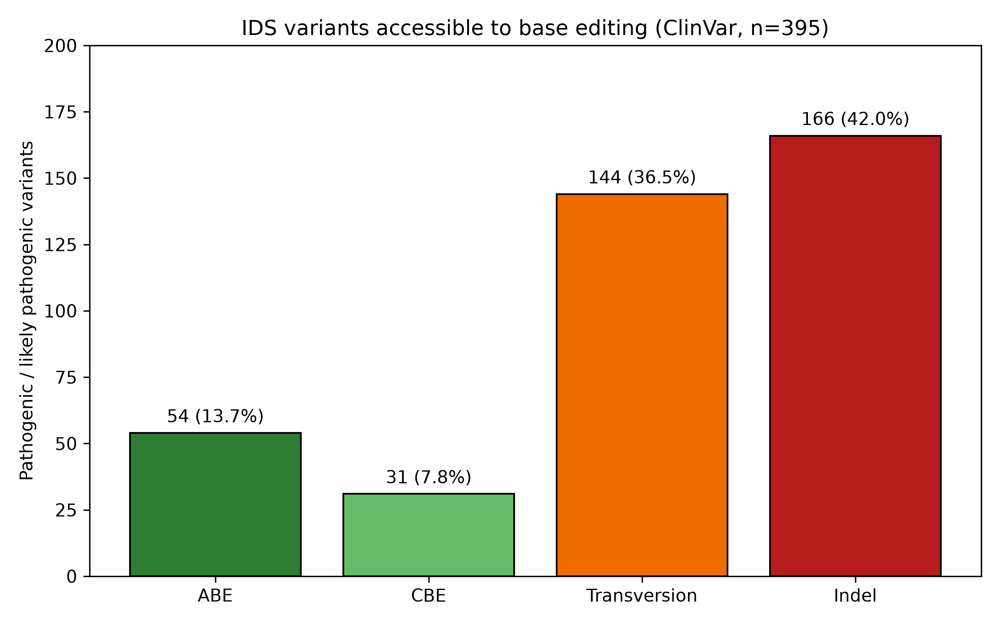
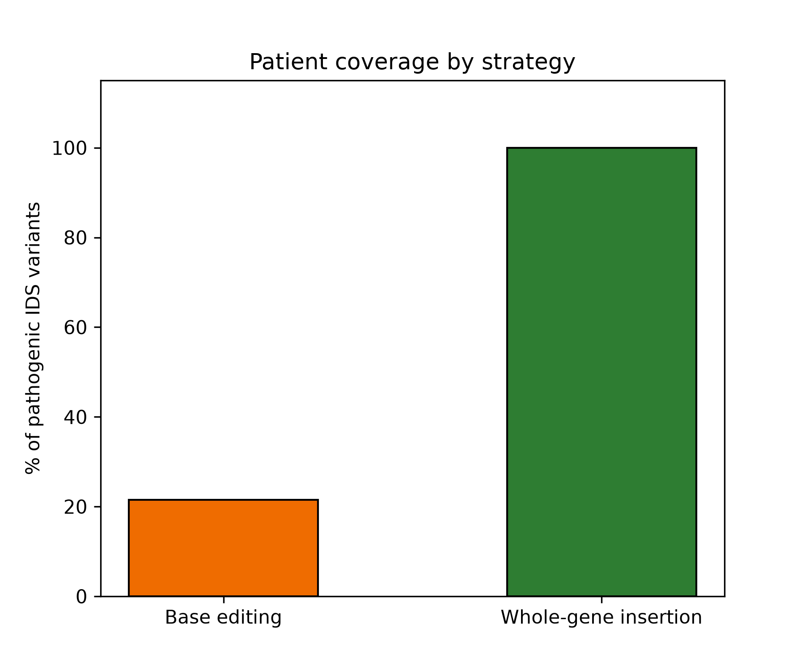
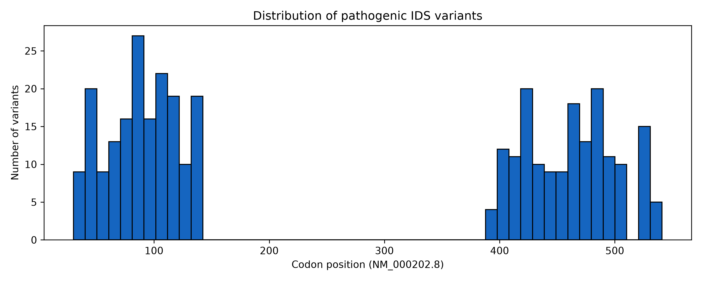

# Mutation spectrum of *IDS* constrains per-mutation editing strategies in Mucopolysaccharidosis type II

**Pantelis Mastakoulis**
National and Kapodistrian University of Athens
October 2026

---

## Summary

Analysis of 395 pathogenic and likely pathogenic *IDS* variants from ClinVar indicates that at most 21.5% are chemically addressable by current base editors, and that no single allele accounts for more than 2% of reported variants. These two properties — chemical inaccessibility and the absence of prevalent alleles — are features of the mutational architecture of the gene rather than limitations of any particular reagent, and they place MPS II in a different regime from monogenic diseases where per-mutation correction has succeeded.

---

## Rationale

Genome editing has produced its clearest therapeutic successes in diseases with a favourable mutational architecture. In sickle cell disease, a single nucleotide substitution in *HBB* accounts for every patient, so one guide RNA and one donor template serve the entire population. In Fanconi anaemia, correction efforts have targeted prevalent *FANCA* alleles, an approach that is tractable precisely because a subset of alleles recurs across patients.

Mucopolysaccharidosis type II is caused by loss-of-function variants in *IDS*, and more than seven hundred pathogenic variants have been described. Whether this allelic heterogeneity constitutes a practical obstacle to per-mutation correction, or merely an inconvenience, has not been quantified.

This analysis asks a narrow question: of the pathogenic *IDS* variants currently catalogued, what fraction could a base editor address even under maximally permissive assumptions?

---

## Methods

**Data source.** Pathogenic and likely pathogenic *IDS* variants were retrieved from ClinVar (accessed 2 October 2026) using the query `IDS[gene]`, filtered to germline classifications of Pathogenic or Likely pathogenic and to variants annotated as affecting a single gene and shorter than 1 kb. The resulting set comprised 395 variants.

**Exclusion of multi-gene rearrangements.** Large multi-gene rearrangements were deliberately excluded. Inspection of this excluded set (n = 99) showed that it consists almost entirely of chromosome-scale copy number changes spanning hundreds of genes, which correspond to contiguous gene syndromes rather than *IDS*-specific disease.

**Consequence assignment.** Each variant was assigned a single primary molecular consequence using a severity hierarchy (frameshift > nonsense > splice > in-frame indel > start loss > missense > synonymous > UTR > intron), since ClinVar reports multiple consequences per variant across transcripts. The assignment was verified by cross-tabulation against variant type; no frameshift variant was annotated as a single-nucleotide change, and no missense variant as an indel.

**Base-editing accessibility.** Accessibility was assessed under deliberately permissive assumptions. A variant was counted as addressable only if:

1. it is a single-nucleotide substitution, since base editors alter base identity without changing sequence length; and
2. the substitution required to restore the reference sequence is a transition achievable by a current editor — adenine base editors install A→G (T→C on the opposite strand) and cytosine base editors install C→T (G→A on the opposite strand).

Transversions are not achievable by either chemistry.

PAM availability, position within the editing window, and bystander editing were **not** modelled. The resulting figure is therefore an upper bound; the achievable fraction is necessarily lower.

**Implementation.** Codon positions were extracted from the canonical *NM_000202.8* numbering. Analysis was performed in Python 3.14 using pandas and matplotlib.

---

## Results

### Two fifths of pathogenic *IDS* variants are structurally inaccessible to base editing

Of the 395 variants analysed, **166 (42.0%)** are insertions, deletions, duplications or complex indels. Because base editors alter base identity without changing sequence length, these variants are outside the reach of any base-editing chemistry, present or future. Frameshift variants alone account for 135 (34.2%) of the set — the second largest consequence class after missense.

**Table 1. Molecular consequence of pathogenic *IDS* variants (n = 395)**

| Consequence | n | % |
|---|---:|---:|
| Missense | 155 | 39.2 |
| Frameshift | 135 | 34.2 |
| Nonsense | 52 | 13.2 |
| Splice | 31 | 7.8 |
| In-frame indel | 17 | 4.3 |
| Intron | 5 | 1.3 |

### Among single-nucleotide variants, most require chemistry that does not exist

The remaining 229 variants (58.0%) are single-nucleotide substitutions and therefore candidates in principle. However, correcting a substitution requires installing the reverse change, and current base editors install transitions only. Of the 229 candidates, **144 (62.9%) arose through transversions** — G>C, G>T, C>A, C>G, T>G, T>A, A>T, A>C — for which no base editor is available.

Only 85 variants are chemically correctable: 54 by an adenine base editor and 31 by a cytosine base editor.

> **This corresponds to 21.5% of all pathogenic *IDS* variants, and represents an upper bound before PAM availability, editing-window position and bystander editing are considered.**

**Table 2. Accessibility of *IDS* variants to base editing**

| Category | n | % of total |
|---|---:|---:|
| Correctable by ABE | 54 | 13.7 |
| Correctable by CBE | 31 | 7.8 |
| SNV, transversion — no editor | 144 | 36.5 |
| Indel — structurally out of reach | 166 | 42.0 |
| **Total addressable** | **85** | **21.5** |

**Figure 1.** Accessibility of pathogenic *IDS* variants to base editing. ABE 54, CBE 31, transversions 144, indels 166 (n = 395).

**Figure 2.** Patient coverage by strategy: per-mutation base editing (upper bound 21.5%) versus mutation-agnostic whole-gene insertion (100%).

### No prevalent allele exists in *IDS*

Codon-level analysis of 347 variants with interpretable protein annotation identified **167 distinct affected codons**, a mean of 2.08 variants per codon. The most frequently affected codon accounts for 7 variants (**2.0%** of the set); the five most frequent together account for 9.5%. Just over half of affected codons (87 of 167) carry a single reported variant.

The mutational landscape is therefore dispersed rather than concentrated. Targeting even the ten most common positions would address a small minority of patients, and each would require its own reagent, guide design and validation path.

**Figure 3.** Distribution of pathogenic variants across the *IDS* coding sequence (NM_000202.8). The interval between codons ~140 and ~390 is empty in the filtered ClinVar set; see Limitations.

---

## Limitations

Several constraints should be stated plainly.

**ClinVar reflects reporting practice rather than population frequency.** The absence of a prevalent allele in this dataset indicates that no single variant dominates the *reported* spectrum; it does not establish allele frequencies in any patient population. A registry-based cohort would be required for that claim, and the conclusion drawn here is correspondingly limited to reported variant diversity.

**A coverage gap exists between c.419 and c.1180.** No variants are catalogued in this interval in the filtered set. This gap is unlikely to be biological. It may reflect under-reporting, or difficulty in unambiguously assigning variants in a region adjacent to the *IDS2* pseudogene, where recombination is known to occur. If variants exist in this interval that are not captured here, the analysis understates rather than overstates the diversity of the mutational spectrum.

**The 21.5% figure is an upper bound** and should not be read as an achievable correction rate. Applying realistic constraints — PAM availability within the editing window, position of the target base within that window, and the presence of bystander bases — would reduce it, in some cases substantially. The direction of this bias is known even though its magnitude is not.

**Prime editing was not modelled.** It is more permissive than base editing, accommodating transversions and small indels, and would therefore extend coverage beyond the figure reported here. It remains, however, a per-mutation approach: each variant requires its own pegRNA design and validation, so the conclusion regarding reagent scaling is unchanged.

---

## Implication

The two findings reported here are properties of the gene rather than of any reagent. Allelic diversity cannot be engineered away, and the chemical restriction of base editors to transitions is intrinsic to the mechanism. Improvements in editor efficiency, specificity or delivery would not alter either result.

This places MPS II in a different category from the diseases where per-mutation correction has been taken furthest. In sickle cell disease a single substitution defines the patient population; in Fanconi anaemia, correction efforts have targeted prevalent *FANCA* alleles. For *IDS*, no comparable shortcut exists: the most common codon accounts for two per cent of reported variants, and four fifths of the spectrum lies outside base-editing chemistry altogether.

Approaches that are indifferent to the patient's specific variant — insertion of a complete functional coding sequence at a defined locus — address the entire spectrum with a single reagent. Recently described RNA-guided bridge recombinases were introduced on precisely this rationale: enabling correction of multiallelic genetic disorders that cannot be addressed with small-scale edits. The present analysis offers a quantitative case for one such disorder.

---

## Data and code availability

Source data: ClinVar, accessed 2 October 2026.
Analysis code: `01_explore_variants.ipynb`
Figures: `results/`
