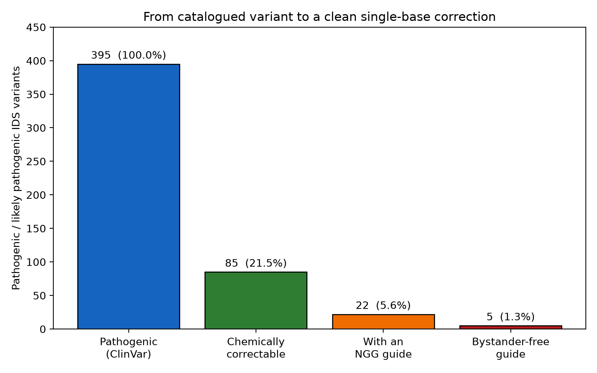
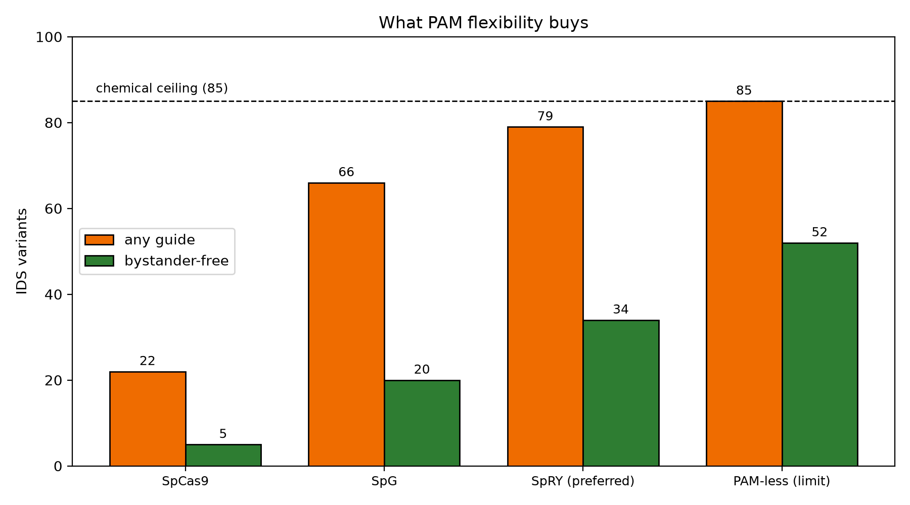
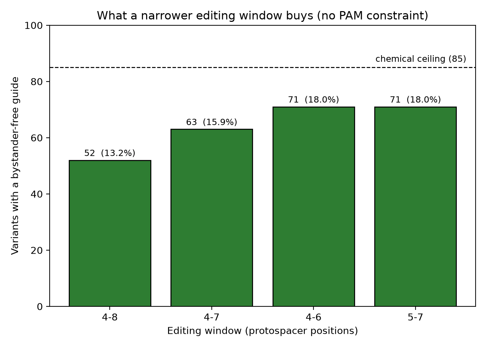
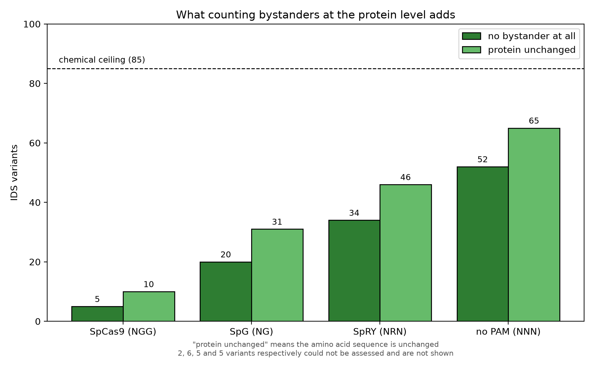

# Realistic coverage of the *IDS* variant spectrum by base editing

**Pantelis Mastakoulis**\
National and Kapodistrian University of Athens\
October 2026

---

## Summary

An earlier analysis of this dataset put an upper bound of 21.5% on the share of pathogenic *IDS* variants that base editing could address, and said plainly that this was a ceiling rather than a realistic rate.

This analysis closes that gap. Once PAM availability, the editing window and bystander editing are taken into account, the figure for a conventional SpCas9 base editor is **1.3%**. Relaxing the PAM requirement raises it to 13.2% at best. Narrowing the editing window raises it further, to 18.0%. Neither reaches 21.5%, because that ceiling is set by the chemistry of the editors and nothing about guide design can move it.

A further step asks whether each bystander actually changes the protein. Judged
that way, the SpCas9 figure rises from 1.3% to **2.5%**, the PAM-less figure from
13.2% to **16.5%**, and a three-position window reaches **19.5%** — ninety per cent
of the chemical ceiling. The bystander barrier is therefore largely a matter of
window width rather than of sequence: fourteen of the fifteen variants that no
PAM can reach fail by a single neighbouring base. What does not move is the
ceiling itself.

---

## Rationale

The preceding report concluded that at most 85 of 395 pathogenic *IDS* variants are chemically correctable, and listed three things it had not modelled: whether a PAM is available, whether the target base falls inside the editing window, and whether neighbouring bases would be changed at the same time. All three can only lower the number. How far was not known.

This analysis answers that. For each of the 85 variants it asks whether a guide RNA exists that places the target base in the editing window with a valid PAM — and if one does, whether it would edit that base and nothing else.

---

## Methods

**The reference sequence.** The *IDS* locus was taken from the GRCh38 assembly through the UCSC Genome Browser, covering chrX:149,481,000 to 149,506,500. That is 25,500 bases, spanning every variant in the dataset with about 1.5 kb to spare at each end. *IDS* is read from the minus strand, so the retrieved sequence is the reverse complement of the coding sequence.

**Checking the coordinates first.** Genomic positions came from the ClinVar export, which also reports the reference base at each position. Before anything else, every single-nucleotide variant was checked against the retrieved sequence: does the base found there match the base ClinVar reports? All 229 agreed, with no exceptions. Nothing further was attempted until this passed, because an error here would have been invisible and would have corrupted every number that followed.

**Which editor corrects which variant.** Correcting a variant means installing the reverse of the change that caused it. An adenine base editor writes A to G; a cytosine base editor writes C to T; either can act on whichever strand carries the base. Applying this gives 85 correctable variants, 54 for an adenine editor and 31 for a cytosine editor — the same classification as the earlier report, reached independently. The strand carrying the base to be edited was recorded, because the PAM has to sit on that same strand.

**What counts as a usable guide.** A guide was modelled as 20 bases of protospacer with the PAM immediately after it, and an editing window covering positions 4 to 8 of the protospacer, counted from the end furthest from the PAM. For each variant there are five ways to place the protospacer so that the target base lands in the window, and all five were tested.

Four PAM requirements were used: `NGG` for ordinary SpCas9, `NG` for SpG, `NRN` for the preferred sites of SpRY, and no requirement at all as a theoretical limit.

**Bystanders.** A base editor cannot tell which base was meant. If the window contains a second base of the same kind, that one changes too. A guide was treated as clean when the window holds exactly one base of the edited type, and a variant as cleanly correctable when at least one of its guides is clean.

**Verifying the result.** The headline count was recomputed a second time by an unrelated route. Instead of testing five placements per variant, the whole 25,500-base interval was scanned on both strands for every `NGG`, the editing window each one implies was recorded, and the variants falling inside those windows were counted. Both methods gave 22.

The scan found 6,779 reachable positions on one strand and 5,873 on the other — 26.6% and 23.0% of the interval, against a theoretical expectation of 27.8%. The small shortfall follows from the GC content of the locus, since `NGG` depends on how often `GG` occurs.

Analysis was done in Python 3.14 with pandas and matplotlib.

---

## Results

### Twenty-two variants have a guide. Five have a clean one.

| | Variants | Share of 395 |
|---|---:|---:|
| Pathogenic or likely pathogenic in ClinVar | 395 | 100% |
| Chemically correctable | 85 | 21.5% |
| With an SpCas9 guide | 22 | 5.6% |
| **With a guide that edits nothing else** | **5** | **1.3%** |

**Figure 4.** What remains of the reported spectrum as each constraint is applied.

Of the 85 chemically correctable variants, 63 have no SpCas9 guide at all. For these, no placement of the protospacer puts the target base in the editing window with a `GG` behind it. Among the 22 that do have a guide, seventeen have exactly one and only five have two — so for most of them there is a single option and no fallback.

The bystander filter then removes seventeen more. Five variants have the target base alone in the window. Twelve have one other base that would be edited alongside it, three have two, and two have three.

Those seventeen are not necessarily lost. Whether a second edit matters depends on what it does to the protein, and a bystander that leaves the amino acid unaltered changes nothing about the product. The next section examines each of them.

### Eleven bystanders leave the protein unchanged

A bystander disqualifies a guide only if it changes the protein. Each bystander
in the SpCas9 guide list was therefore placed in its codon and translated.

The reading frame was reconstructed from the protospacer itself: the target base
has a known position both in the protospacer and in the coding sequence, which
fixes the correspondence between the two for every other base in the window.
*IDS* is read from the minus strand, so a guide acting on the plus strand runs
opposite to the coding direction and its bases must be complemented. The
reconstruction was checked before use — for all 24 guides whose variant carries
a protein annotation in ClinVar, the rebuilt codon translates to the amino acid
and codon number ClinVar reports.

Thirty bystander edits appear across the 27 guides. Four belong to two variants
with intronic targets, which have no codon and were not assessed. Of the
remaining twenty-six, **eleven are synonymous** and fifteen change the amino
acid. None of these creates a premature stop.

| | Variants | Share of 395 |
|---|---:|---:|
| With an SpCas9 guide | 22 | 5.6% |
| With a guide that edits nothing else | 5 | 1.3% |
| **With a guide that leaves the protein unchanged** | **10** | **2.5%** |
| Intronic target, not assessed | 2 | — |

Five variants gain a guide this way: c.140T>C, c.325T>C, c.1420C>T, c.1561G>A
and c.1568A>G. The count doubles, and it moves in favour of base editing —
against the conclusion the rest of this report reaches.

A synonymous change is not the same as a harmless one. It leaves the amino acid
sequence intact, which is all that is claimed here; effects on splicing, on mRNA
stability or on translation were not examined.

### PAM flexibility helps a great deal, and then stops

| Editor | PAM | Any guide | Clean guide | Share of 395 |
|---|---|---:|---:|---:|
| SpCas9 | NGG | 22 | 5 | 1.3% |
| SpG | NG | 66 | 20 | 5.1% |
| SpRY | NRN | 79 | 34 | 8.6% |
| no PAM requirement | — | 85 | 52 | 13.2% |

**Figure 5.** Variants with any guide, and with a clean guide, as the PAM requirement is relaxed. The dashed line marks the 85 chemically correctable variants.

Relaxing the PAM is worth a lot. SpG roughly triples coverage over SpCas9, and SpRY reaches a fifth of the spectrum when any guide will do.

But once clean editing is required, an editor with no PAM requirement whatsoever still reaches only 52 of the 85 variants — 13.2% of the spectrum. The other 33 carry a bystander in every possible placement of the window, and no amount of PAM engineering removes it.

This means the 21.5% in the earlier report was generous. It is the ceiling for correction of any kind. The ceiling for correcting one base and leaving the rest alone is lower.

### A narrower window closes most of what remains

Narrowing the editing window from five positions to three raises clean coverage from 52 variants to 71 — from 13.2% to 18.0% of the spectrum. A four-position window gives 63, or 15.9%. Windows covering positions 4 to 6 and positions 5 to 7 give exactly the same answer, which says that what matters is how wide the window is, not where it sits.

**Figure 6.** Variants with a clean guide as the editing window narrows, with no PAM requirement imposed.

For SpCas9 in particular, narrowing the window costs nothing at all. The number of variants with any guide falls from 22 to 10, but the number with a clean guide does not fall — it rises slightly, from five to seven. The guides lost to a narrower window were, in this dataset, guides that would have edited more than the target.

### The same two ladders, counted at the protein level

The two sections above apply the strict rule, under which any bystander
disqualifies a guide. Recomputed at the level of the amino acid, both ladders
move.

| Editor | PAM | Strict | Protein level | Share of 395 | Not assessed |
|---|---|---:|---:|---:|---:|
| SpCas9 | NGG | 5 | **10** | 2.5% | 2 |
| SpG | NG | 20 | **31** | 7.8% | 6 |
| SpRY | NRN | 34 | **46** | 11.6% | 5 |
| no PAM requirement | — | 52 | **65** | 16.5% | 5 |

**Figure 7.** Variants with a bystander-free guide, and with a guide that leaves the protein unchanged, as the PAM requirement is relaxed.

Narrowing the window does the same, and goes further:

| Window | Width | Strict | Protein level | Share of 395 | Not assessed |
|---|---:|---:|---:|---:|---:|
| 4–8 | 5 | 52 | **65** | 16.5% | 5 |
| 4–7 | 4 | 63 | **72** | 18.2% | 5 |
| 4–6 | 3 | 71 | **77** | 19.5% | 3 |
| 5–7 | 3 | 71 | **77** | 19.5% | 3 |

At the narrowest window with no PAM requirement, 77 of the 85 chemically
correctable variants have a guide that leaves the protein unchanged — just over
ninety per cent of the chemical ceiling, and 19.5% of the reported spectrum.
Three more have intronic targets and cannot be assessed this way. Five remain.

A guide with no bystander at all leaves the protein unchanged by definition, so
the protein-level column can never fall below the strict one. It does not, in any
row of either table.

### What decides whether a bystander matters

Across every placement allowed without a PAM requirement, 396 bystander edits
fall inside the editing window of a variant with a coding target. Their position
within the codon decides almost everything about them.

| Position in codon | Bystanders | Synonymous | Share |
|---|---:|---:|---:|
| First | 149 | 20 | 13% |
| Second | 115 | **0** | **0%** |
| Third | 132 | 127 | **96%** |

The editing window knows nothing about codons, and the bystanders fall across the
three positions almost evenly — 149, 115 and 132. What becomes of them does not.
A bystander in the third position is harmless in ninety-six cases out of a
hundred. In the second position it was harmless in none of 115, which is what the
genetic code requires: outside the stop codons, no transition at the second
position of a codon leaves the amino acid unchanged.

The placement is blind. The consequence is not.

This also makes the question answerable without translating anything. The phase
of a bystander within its codon predicts what it will do.

Of the 396, 147 are synonymous, 239 change the amino acid, and **ten create a
premature stop**.

### The two editors are not equivalent

All ten premature stops arise from a cytosine editor. An adenine editor produced
none in 196 bystanders.

This follows from the code rather than from the data. On the coding strand a
cytosine editor writes C→T or G→A, which turns CAA into TAA, CAG into TAG, CGA
into TGA, and TGG into TGA or TAG. An adenine editor writes A→G or T→C: the first
cannot create the thymine that every stop codon begins with, and the second
destroys it.

The two also differ in where their bystanders land.

| Position in codon | ABE | | CBE | |
|---|---:|---:|---:|---:|
| First | 71 | 36% | 78 | 39% |
| Second | 77 | **39%** | 38 | 19% |
| Third | 48 | 25% | 84 | **42%** |

An adenine editor acts on A and T, a cytosine editor on C and G, and these are
not distributed alike across the three codon positions in this gene. The result
is a mirror image: the adenine editor concentrates its bystanders where the code
is strict, the cytosine editor where it is permissive. Across all 396, 48.5% of
cytosine-editor bystanders are synonymous against 25.5% for the adenine editor.

The two editors therefore carry different kinds of risk rather than different
amounts of it. A cytosine editor is forgiven about twice as often, and carries
every one of the catastrophic outcomes. An adenine editor is forgiven less often
and produced no catastrophic outcome at all. Whether this holds in other genes
was not examined.

### Five variants no geometry reaches

With the five-position window and no PAM requirement, fifteen variants have a
guide but none that leaves the protein unchanged. Fourteen of the fifteen fail by
a single harmful bystander; the remaining one fails by two. None is buried deeply.

That margin is what a narrower window removes. At three positions, ten of the
fifteen are recovered and five remain:

| Variant | Codon | Editor |
|---|---|---|
| c.134A>G | Asp45 | CBE |
| c.136G>A | Asp46 | ABE |
| c.215T>C | Leu72 | CBE |
| c.283A>G | Arg95 | CBE |
| c.328A>G | Arg110 | CBE |

These five carry a protein-changing bystander in every placement of the window,
on either strand, under any PAM. No improvement in guide design or in nuclease
engineering reaches them; only a different mechanism would.

All five fall between codons 45 and 110, in the amino-terminal cluster of the
reported spectrum. The narrower window recovered every one of the five that lay
in the carboxy-terminal cluster, leaving that half of the gene with none. Four of
the five are cytosine editors, against 36% of the editable set, but five is too
small a number to support a claim.

---

## Limitations

**The model is geometric, not kinetic.** The editing window is treated as a hard edge, whereas real editors lose activity gradually across it. A variant counted as reachable may in practice be edited poorly, and one counted as unreachable may be edited a little. This error does not run in one direction only, and it weighs more heavily on the results above than on the earlier ones: fourteen of the fifteen variants that no PAM reaches are decided by a single base, and a base at the edge of the window is the one an editor is least likely to touch.

**Only SpCas9 geometry was modelled.** Editors built on other nucleases use different protospacer lengths and different windows, and were not considered.

**Off-target activity was not examined.** Only the *IDS* locus was looked at, so nothing here says whether a guide would also bind elsewhere in the genome.

**Bystander consequences were evaluated only at the level of the amino acid.** A synonymous bystander is counted as leaving the protein unchanged, which says nothing about splicing, mRNA stability or translation. Where a bystander could not be judged — an intronic target, or a codon that does not fit inside the twenty bases of the protospacer — the variant is reported separately as not assessed, rather than counted on either side.

**The bystander counts in the second half are taken from the placements allowed without a PAM requirement.** That set contains every possible placement of the window, each one once. Counting across the four PAM requirements instead would count the same guide up to four times.

**The reference sequence was used throughout.** A patient's protospacer differs from the reference at the target position. That does not affect whether a PAM exists, but it does affect how well the guide binds.

**Efficiency, delivery and safety are outside the scope**, as in the earlier report. These numbers describe what could be designed, not what would work.

**The dataset carries the same limitations as before.** ClinVar records what has been reported rather than what is common in patients, and the stretch between c.419 and c.1180 is unrepresented.

---

## Implication

The earlier report argued that allelic diversity puts MPS II beyond the reach of per-mutation correction at scale, and that 21.5% was an upper bound. Both hold. What has changed is which of the three constraints does the work.

Two of them are engineering problems, and both give way. PAM flexibility takes protein-level coverage from 2.5% to 16.5%. A narrower window takes it to 19.5% — just over ninety per cent of what the chemistry allows. Counted strictly, with any bystander disqualifying a guide, the same two levers stop at 18.0%. Either way, the bystander barrier turns out to be largely a question of how wide the window is, and fourteen of the fifteen variants it still blocks are blocked by a single base.

The third constraint does not give way at all. Base editors install transitions, four fifths of the reported spectrum needs something else, and no guide, window or nuclease changes that. Nor does the dispersion of the spectrum across 167 codons, which is a property of the gene.

A strategy that does not care which variant a patient carries is not bound by any of this. Guides, windows and PAMs have no bearing on the insertion of a complete working copy of the gene, which covers the reported spectrum with one reagent whatever the variant. That remains a claim about coverage, not about efficacy, delivery or safety.

What this analysis adds is the size of the gap and where it comes from. For *IDS*, with an SpCas9 base editor as it exists today, it runs from 2.5% to 100%. With every geometric constraint relaxed to its limit it still runs from 19.5% to 100%, and that remainder is chemistry.

---

## References

1. Landrum MJ, Lee JM, Benson M, Brown GR, Chao C, Chitipiralla S, et al. ClinVar: improving access to variant interpretations and supporting evidence. *Nucleic Acids Research* 2018;46(D1):D1062–D1067. doi:10.1093/nar/gkx1153

2. Komor AC, Kim YB, Packer MS, Zuris JA, Liu DR. Programmable editing of a target base in genomic DNA without double-stranded DNA cleavage. *Nature* 2016;533(7603):420–424. doi:10.1038/nature17946

3. Gaudelli NM, Komor AC, Rees HA, Packer MS, Badran AH, Bryson DI, Liu DR. Programmable base editing of adenine to guanine in genomic DNA without DNA cleavage. *Nature* 2017;551(7681):464–471. doi:10.1038/nature24644

4. Walton RT, Christie KA, Whittaker MN, Kleinstiver BP. Unconstrained genome targeting with near-PAMless engineered CRISPR-Cas9 variants. *Science* 2020;368(6488):290–296. doi:10.1126/science.aba8853

5. Anzalone AV, Randolph PB, Davis JR, Sousa AA, Koblan LW, Levy JM, et al. Search-and-replace genome editing without double-strand breaks or donor DNA. *Nature* 2019;576(7785):149–157. doi:10.1038/s41586-019-1711-4

6. Durrant MG, Perry NT, Pai JJ, Jangid AR, Athukoralage JS, Hiraizumi M, et al. Bridge RNAs direct programmable recombination of target and donor DNA. *Nature* 2024;630(8018):984–993. doi:10.1038/s41586-024-07552-4

7. Pelea O, Tálas A, Fernández Carrera J, Mathis N, van de Venn L, Yeh CD, et al. Programmable genome editing in human cells using RNA-guided bridge recombinases. *Science* 2026;391:eadz1884. doi:10.1126/science.adz1884

---

## Data and code availability

Repository: https://github.com/PantelisMastakoulis/IDS-variant-analysis \
Source data: ClinVar, accessed 2 October 2026; reference sequence from GRCh38 via the UCSC Genome Browser.\
Analysis code: `02_pam_accessibility.ipynb`, `03_bystander_consequences.ipynb`, `04_pam_consequences.ipynb`\
Preceding report: `REPORT.md`\
Figures: `results/`