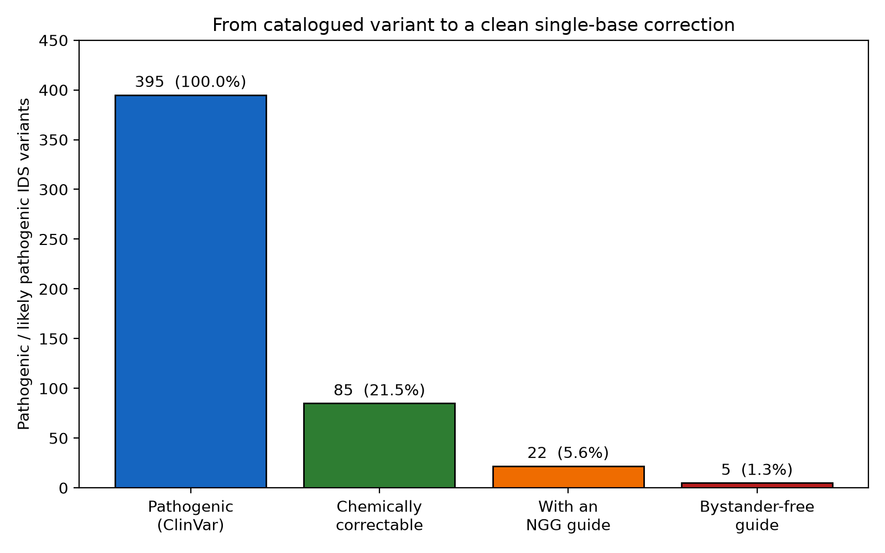
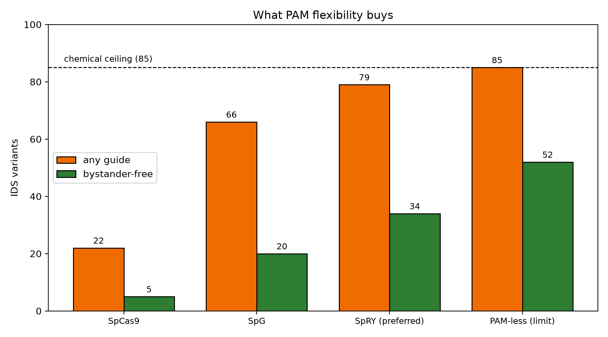
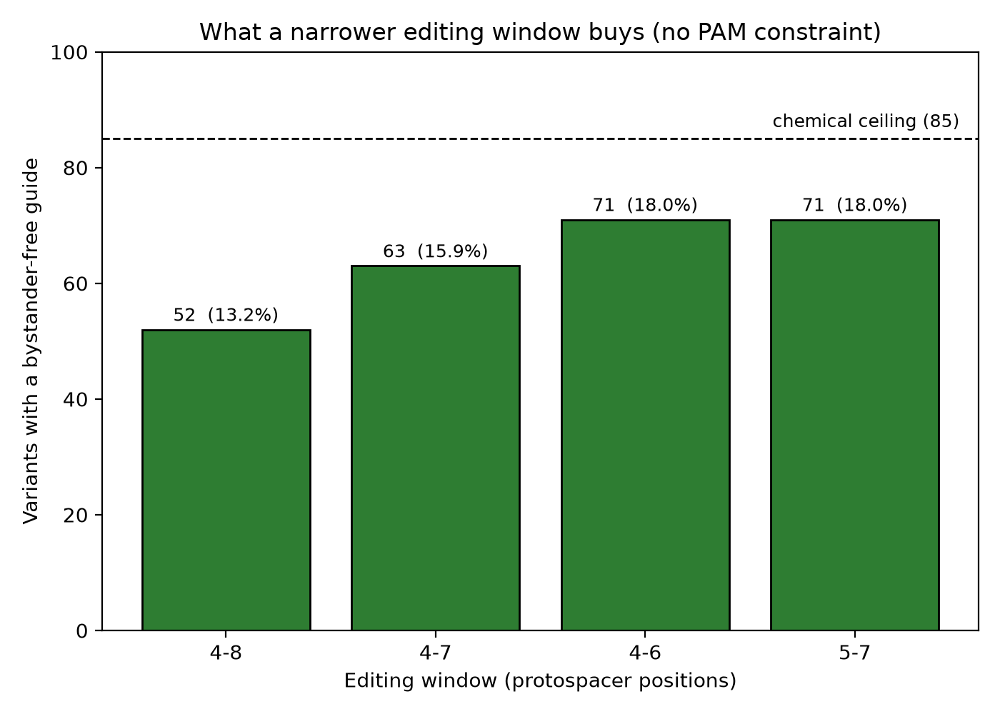

# Realistic coverage of the *IDS* variant spectrum by base editing

**Pantelis Mastakoulis**\
National and Kapodistrian University of Athens\
October 2026

---

## Summary

An earlier analysis of this dataset put an upper bound of 21.5% on the share of pathogenic *IDS* variants that base editing could address, and said plainly that this was a ceiling rather than a realistic rate.

This analysis closes that gap. Once PAM availability, the editing window and bystander editing are taken into account, the figure for a conventional SpCas9 base editor is **1.3%**. Relaxing the PAM requirement raises it to 13.2% at best. Narrowing the editing window raises it further, to 18.0%. Neither reaches 21.5%, because that ceiling is set by the chemistry of the editors and nothing about guide design can move it.

---

## Rationale

The preceding report concluded that at most 85 of 395 pathogenic *IDS* variants are chemically correctable, and listed three things it had not modelled: whether a PAM is available, whether the target base falls inside the editing window, and whether neighbouring bases would be changed at the same time. All three can only lower the number. How far was not known.

This analysis answers that. For each of the 85 variants it asks whether a guide RNA exists that places the target base in the editing window with a valid PAM — and if one does, whether it would edit that base and nothing else.

---

## Methods

**The reference sequence.** The *IDS* locus was taken from the GRCh38 assembly through the UCSC Genome Browser, covering chrX:149,481,000 to 149,506,500. That is 25,500 bases, spanning every variant in the dataset with about 1.5 kb to spare at each end. *IDS* is read from the minus strand, so the retrieved sequence is the reverse complement of the coding sequence.

**Checking the coordinates first.** Genomic positions came from the ClinVar export, which also reports the reference base at each position. Before anything else, every single-nucleotide variant was checked against the retrieved sequence: does the base found there match the base ClinVar reports? All 229 agreed, with no exceptions. Nothing further was attempted until this passed, because an error here would have been invisible and would have corrupted every number that followed.

**Which editor corrects which variant.** Correcting a variant means installing the reverse of the change that caused it. An adenine base editor writes A to G; a cytosine base editor writes C to T; either can act on whichever strand carries the base. Applying this gives 85 correctable variants, 54 for an adenine editor and 31 for a cytosine editor — the same classification as the earlier report, reached independently. The strand carrying the base to be edited was recorded, because the PAM has to sit on that same strand.

**What counts as a usable guide.** A guide was modelled as 20 bases of protospacer with the PAM immediately after it, and an editing window covering positions 4 to 8 of the protospacer, counted from the end furthest from the PAM. For each variant there are five ways to place the protospacer so that the target base lands in the window, and all five were tested.

Four PAM requirements were used: `NGG` for ordinary SpCas9, `NG` for SpG, `NRN` for the preferred sites of SpRY, and no requirement at all as a theoretical limit.

**Bystanders.** A base editor cannot tell which base was meant. If the window contains a second base of the same kind, that one changes too. A guide was treated as clean when the window holds exactly one base of the edited type, and a variant as cleanly correctable when at least one of its guides is clean.

**Verifying the result.** The headline count was recomputed a second time by an unrelated route. Instead of testing five placements per variant, the whole 25,500-base interval was scanned on both strands for every `NGG`, the editing window each one implies was recorded, and the variants falling inside those windows were counted. Both methods gave 22.

The scan found 6,779 reachable positions on one strand and 5,873 on the other — 26.6% and 23.0% of the interval, against a theoretical expectation of 27.8%. The small shortfall follows from the GC content of the locus, since `NGG` depends on how often `GG` occurs.

Analysis was done in Python 3.14 with pandas and matplotlib.

---

## Results

### Twenty-two variants have a guide. Five have a clean one.

| | Variants | Share of 395 |
|---|---:|---:|
| Pathogenic or likely pathogenic in ClinVar | 395 | 100% |
| Chemically correctable | 85 | 21.5% |
| With an SpCas9 guide | 22 | 5.6% |
| **With a guide that edits nothing else** | **5** | **1.3%** |

**Figure 4.** What remains of the reported spectrum as each constraint is applied.

Of the 85 chemically correctable variants, 63 have no SpCas9 guide at all. For these, no placement of the protospacer puts the target base in the editing window with a `GG` behind it. Among the 22 that do have a guide, seventeen have exactly one and only five have two — so for most of them there is a single option and no fallback.

The bystander filter then removes seventeen more. Five variants have the target base alone in the window. Twelve have one other base that would be edited alongside it, three have two, and two have three.

Those twelve are not necessarily lost. Whether a second edit matters depends on what it does to the protein, and a change that leaves the amino acid unaltered would be harmless. That was not examined here, and it is left open rather than counted either way.

### PAM flexibility helps a great deal, and then stops

| Editor | PAM | Any guide | Clean guide | Share of 395 |
|---|---|---:|---:|---:|
| SpCas9 | NGG | 22 | 5 | 1.3% |
| SpG | NG | 66 | 20 | 5.1% |
| SpRY | NRN | 79 | 34 | 8.6% |
| no PAM requirement | — | 85 | 52 | 13.2% |

**Figure 5.** Variants with any guide, and with a clean guide, as the PAM requirement is relaxed. The dashed line marks the 85 chemically correctable variants.

Relaxing the PAM is worth a lot. SpG roughly triples coverage over SpCas9, and SpRY reaches a fifth of the spectrum when any guide will do.

But once clean editing is required, an editor with no PAM requirement whatsoever still reaches only 52 of the 85 variants — 13.2% of the spectrum. The other 33 carry a bystander in every possible placement of the window, and no amount of PAM engineering removes it.

This means the 21.5% in the earlier report was generous. It is the ceiling for correction of any kind. The ceiling for correcting one base and leaving the rest alone is lower.

### A narrower window closes most of what remains

Narrowing the editing window from five positions to three raises clean coverage from 52 variants to 71 — from 13.2% to 18.0% of the spectrum. A four-position window gives 63, or 15.9%. Windows covering positions 4 to 6 and positions 5 to 7 give exactly the same answer, which says that what matters is how wide the window is, not where it sits.

**Figure 6.** Variants with a clean guide as the editing window narrows, with no PAM requirement imposed.

For SpCas9 in particular, narrowing the window costs nothing at all. The number of variants with any guide falls from 22 to 10, but the number with a clean guide does not fall — it rises slightly, from five to seven. The guides lost to a narrower window were, in this dataset, guides that would have edited more than the target.

---

## Limitations

**The model is geometric, not kinetic.** The editing window is treated as a hard edge, whereas real editors lose activity gradually across it. A variant counted as reachable may in practice be edited poorly, and one counted as unreachable may be edited a little. This error does not run in one direction only.

**Only SpCas9 geometry was modelled.** Editors built on other nucleases use different protospacer lengths and different windows, and were not considered.

**Off-target activity was not examined.** Only the *IDS* locus was looked at, so nothing here says whether a guide would also bind elsewhere in the genome.

**Bystander consequences were not evaluated.** Any bystander was counted as disqualifying, whether or not it would change the protein. The twelve variants with a single bystander would need checking at the codon level before being excluded.

**The reference sequence was used throughout.** A patient's protospacer differs from the reference at the target position. That does not affect whether a PAM exists, but it does affect how well the guide binds.

**Efficiency, delivery and safety are outside the scope**, as in the earlier report. These numbers describe what could be designed, not what would work.

**The dataset carries the same limitations as before.** ClinVar records what has been reported rather than what is common in patients, and the stretch between c.419 and c.1180 is unrepresented.

---

## Implication

The earlier report argued that allelic diversity puts MPS II beyond the reach of per-mutation correction at scale, and that 21.5% was an upper bound. Both hold, and the second is firmer than it was.

There are two levers available to anyone building better editors, and they run out at different points. PAM flexibility takes clean coverage from 1.3% to 13.2% — a tenfold gain, and the larger of the two. A narrower editing window takes it from 13.2% to 18.0%. Neither reaches 21.5%, and nothing goes past it, because the restriction of base editors to transitions belongs to the chemistry rather than to any particular reagent.

A strategy that does not care which variant a patient carries is not bound by any of this. Guides, windows and PAMs have no bearing on the insertion of a complete working copy of the gene, which covers the reported spectrum with one reagent whatever the variant. That remains a claim about coverage, not about efficacy, delivery or safety.

What this analysis adds is the size of the gap. For *IDS*, with the reagents that exist today, it runs from 1.3% to 100%.

---

## References

1. Landrum MJ, Lee JM, Benson M, Brown GR, Chao C, Chitipiralla S, et al. ClinVar: improving access to variant interpretations and supporting evidence. *Nucleic Acids Research* 2018;46(D1):D1062–D1067. doi:10.1093/nar/gkx1153

2. Komor AC, Kim YB, Packer MS, Zuris JA, Liu DR. Programmable editing of a target base in genomic DNA without double-stranded DNA cleavage. *Nature* 2016;533(7603):420–424. doi:10.1038/nature17946

3. Gaudelli NM, Komor AC, Rees HA, Packer MS, Badran AH, Bryson DI, Liu DR. Programmable base editing of adenine to guanine in genomic DNA without DNA cleavage. *Nature* 2017;551(7681):464–471. doi:10.1038/nature24644

4. Walton RT, Christie KA, Whittaker MN, Kleinstiver BP. Unconstrained genome targeting with near-PAMless engineered CRISPR-Cas9 variants. *Science* 2020;368(6488):290–296. doi:10.1126/science.aba8853

5. Anzalone AV, Randolph PB, Davis JR, Sousa AA, Koblan LW, Levy JM, et al. Search-and-replace genome editing without double-strand breaks or donor DNA. *Nature* 2019;576(7785):149–157. doi:10.1038/s41586-019-1711-4

6. Durrant MG, Perry NT, Pai JJ, Jangid AR, Athukoralage JS, Hiraizumi M, et al. Bridge RNAs direct programmable recombination of target and donor DNA. *Nature* 2024;630(8018):984–993. doi:10.1038/s41586-024-07552-4

7. Pelea O, Tálas A, Fernández Carrera J, Mathis N, van de Venn L, Yeh CD, et al. Programmable genome editing in human cells using RNA-guided bridge recombinases. *Science* 2026;391:eadz1884. doi:10.1126/science.adz1884

---

## Data and code availability

Repository: https://github.com/PantelisMastakoulis/IDS-variant-analysis \
Source data: ClinVar, accessed 2 October 2026; reference sequence from GRCh38 via the UCSC Genome Browser.\
Analysis code: `02_pam_accessibility.ipynb`\
Preceding report: `REPORT.md`\
Figures: `results/`